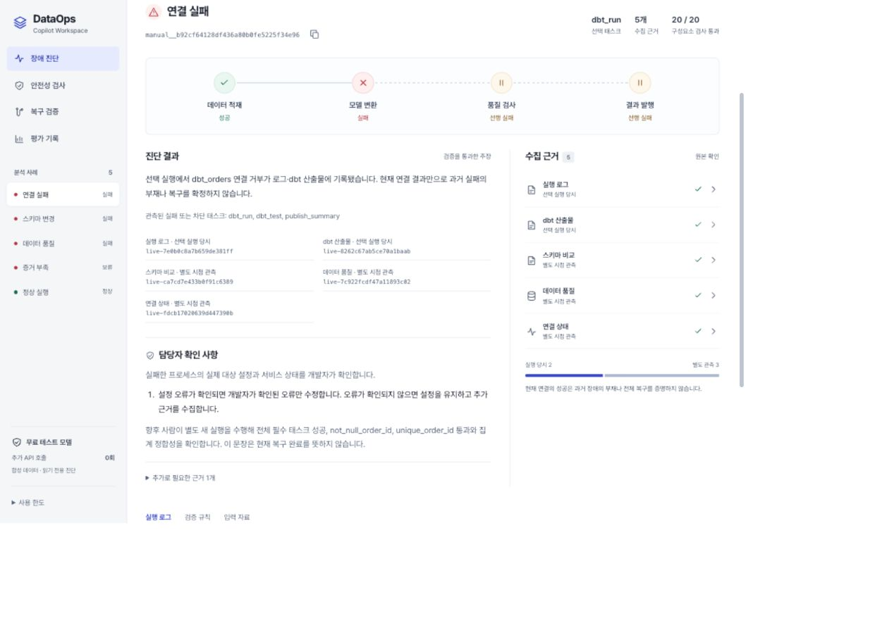
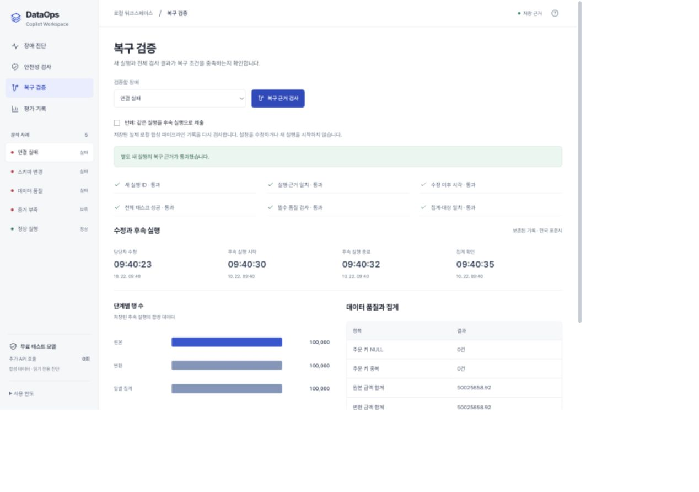
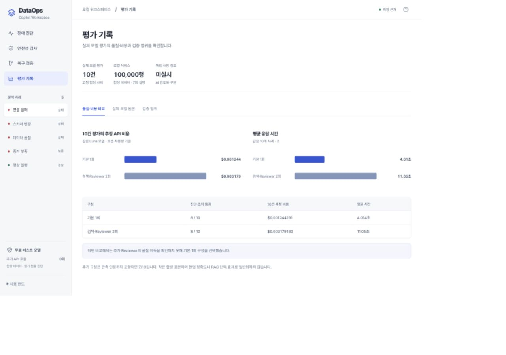

# DataOps Evidence Copilot

## 1. 프로젝트 개요

**실행 근거를 검증하고, 근거가 부족하면 판단을 보류하는 읽기 전용 DataOps 진단 도구**

| 항목 | 내용 |
|---|---|
| 제출물 | SKALA AI Agent 프로젝트 최종 보고서 |
| 작성자 | 임준혁 |
| 교육과정 | SKALA |
| 작성일 | 2026년 10월 22일 |
| 구현 버전 | 진단 엔진 v0.3.1 · 통합 웹 UI |
| 소스 코드 | [GitHub 저장소](https://github.com/dlawnsgur550/dataops-evidence-copilot) |
| 최종 보고서 | [이 README의 직접 주소](https://github.com/dlawnsgur550/dataops-evidence-copilot/blob/main/README.md) |

Airflow 태스크가 실패했을 때 로그, dbt 산출물, 스키마, 데이터 품질, 연결 상태를 모아 원인과 담당자의 확인 절차를 제시합니다. 모델이 만든 주장을 그대로 출력하지 않고, **실행 ID·대상·관측 시점과 코드 규칙을 통과한 내용만 문장으로 만듭니다.** 설정 변경과 복구 실행은 담당자가 수행합니다.

> 기본 웹은 API 키 없이 무료 테스트 모델(FakeLLM)과 저장 근거로 동작합니다. 과거 실제 모델 평가와 실제 로컬 서비스 실험은 별도 기록입니다. 모든 실험 데이터는 합성 데이터이며, 현업 운영 정확도를 검증한 결과는 아닙니다.

[빠른 실행](#7-실행-방법) · [시연 순서](#5-주요-기능과-시연) · [검증 결과](#6-검증-결과와-비용) · [한계와 교훈](#8-한계-트레이드오프와-교훈)

## 2. 기존 문제와 개선 사항

| 기존 문제·해결 과제 | 구현한 개선 | 확인 방법 |
|---|---|---|
| 자유 문장에 근거 없는 원인이나 설정 변경이 섞일 수 있음 | 원인 범주·근거 ID·설정 오류 여부·조치 제안을 유한한 구조로 제한하고 R00–R17 규칙으로 판정 | [주장 계약](src/dataops_copilot/claim_contract.py), [검증·렌더링](src/dataops_copilot/claim_engine.py) |
| 다른 실행이나 다른 연결의 자료가 진단에 섞일 수 있음 | DAG·run·task·시도 번호와 테이블·연결·호출 영수증의 일치 검사 | 잘못된 실행키 입력 시 UNKNOWN·조치 없음·상태 그래프 미표시 |
| 현재 연결 성공을 과거 장애의 부재나 복구로 오해 | 실행 당시 스냅샷과 별도 시점 관측을 구분 | 진단 인용 근거와 상세 창에 관측 범위를 함께 표시 |
| Reviewer가 올바른 조건부 조치까지 거절 | Reviewer의 반례를 코드 위반과 대조하고, 근거 없는 거절은 기록하면서 검증된 진단 유지 | Reviewer 과잉 거절 반례 |
| 같은 실패 실행을 복구 성공으로 재사용 | 별도 새 실행, 수정 이후 시각, 전체 태스크·필수 검사·집계 일치를 모두 요구 | 새 실행 통과 / 같은 실행 반례 거절 |
| 추가 모델 호출의 효과와 비용이 불명확 | 같은 모델·같은 10개 합성 사례에서 기본 1회와 검색·Reviewer 2회 구성을 비교 | 품질 이득을 확인하지 못해 기본 1회 구성을 선택 |
| 설정·진단·시연 화면이 분산 | 하나의 웹에 장애 진단·안전성 검사·복구 검증·평가 기록 통합 | 근거 연결, 파이프라인, 실제 수치 그래프, 모바일 메뉴 |

## 3. 아키텍처와 처리 흐름

아래는 **현재 기본 웹과 CLI가 사용하는 v3.1 경로**입니다. 기본 구성은 검색·모델 Reviewer를 생략하고, 확장 구성에서 두 기능을 추가합니다.

~~~mermaid
flowchart TD
    A["실행 선택 또는 실행키 JSON"] --> B["읽기 전용 근거 수집 또는 저장 근거 재생"]
    B --> C{"구성 선택"}
    C -->|"기본"| D["고정 절차 식별자 목록"]
    C -->|"확장 --full"| E["E5·Qdrant + BM25 → RRF 검색"]
    D --> F["Proposer: 구조화된 주장 생성"]
    E --> F
    F --> G["R00–R17: 근거·원인·관측·조치 검사"]
    G --> H{"모델 Reviewer 사용"}
    H -->|"확장 구성"| I["Reviewer 반례 생성"]
    I --> J["반례를 실제 코드 위반과 대조"]
    H -->|"기본 구성"| K["검증된 주장만 문장으로 렌더링"]
    J --> K
    K --> L["원인·현재 관측·조건부 사람 조치·원본 근거"]
    L --> M["담당자 확인 및 별도 후속 실행"]
    M --> N["새 실행·전체 검사·집계 정합성으로 복구 판정"]
~~~

- **근거 수집:** 실행 로그, dbt 산출물, 스키마 차이, 데이터 품질, 연결 상태의 5종 인터페이스를 사용합니다.
- **판단 보류:** 근거가 없거나 실행·대상이 맞지 않으면 원인을 확정하지 않고 UNKNOWN으로 반환합니다.
- **조치의 의미:** “설정 오류가 확인되면 수정하고, 미확인이면 유지하며 추가 근거를 수집”하는 담당자 절차입니다. 에이전트가 설정을 바꾸거나 DAG를 재실행하지 않습니다.
- **복구의 의미:** 진단 문장의 “확인해 보세요”와 실제 새 실행의 성공을 분리합니다.

## 4. 적용 기술과 구현 범위

| 기술 요소 | 실제 적용 내용 | 범위·코드 |
|---|---|---|
| Multi-Agent 역할 분리 | Proposer가 구조화 주장을 만들고, 확장 구성의 Reviewer가 반례를 제시 | [현재 워크플로](src/dataops_copilot/workflow_v3.py). 기본은 1회, 확장은 2회 모델 단계이며 자동 재시도·동적 재계획 없음 |
| LangGraph | 초기 경로에 triage → inspector → investigate → rca → reviewer 및 제한된 revise 분기 구현 | [초기 StateGraph](src/dataops_copilot/workflow.py). 현재 웹 기본 경로는 비용과 판정 통제를 위한 순차 실행이므로, 현재 화면 전체를 Supervisor·동적 재계획 구현으로 표현하지 않음 |
| MCP | FastMCP와 실제 stdio ClientSession을 통한 읽기 전용 도구 5종, Pydantic 입출력, 대상 허용 목록 | [서버](src/dataops_copilot/mcp_server.py), [클라이언트](src/dataops_copilot/mcp_client.py). 별도 MCP Resource·Prompt 등록은 미구현 |
| RAG | 확장 구성에서 로컬 multilingual-e5-small ONNX, Qdrant 의미 검색, BM25, RRF 결합, 서로 다른 문서 상위 3개 주입 | [Hybrid 검색](src/dataops_copilot/hybrid.py). 기본 구성은 검색을 생략하며 유료 임베딩 사용 없음 |
| 모듈화·의존성 주입 | 도구·모델·검색기·정책·제한을 주입하고 수집·판정·렌더링·복구 검사를 분리 | [프로젝트 정책](config/project.json), [복구 판정](src/dataops_copilot/recovery_v3.py) |
| 관측 가능성 | trace ID, 노드 순서, 근거 해시, 검색 기록, 최초 거절 후보, 토큰·추정 비용을 JSON에 보존 | 로컬 추적은 구현. LangSmith 외부 트레이싱은 적용하지 않음 |
| 평가 | 정답·규칙 기반 검사, 무료 반례·재생, 실제 모델 소수 비교, AI 근거 검토 기록 | 모델 Reviewer는 독립 LLM-as-a-Judge 평가와 다름. 독립 Judge·독립 사람 평가는 미실시 |
| 웹·디자인 | Python 표준 HTTP 서버 + HTML·CSS·JavaScript, 로컬 Pretendard, SVG 파이프라인·비교 그래프, 반응형 화면 | [웹 서버](src/dataops_copilot/web_server.py), [디자인 규칙](DESIGN.md). Impeccable·Vercel 지침을 참고 |
| 보안·비용 통제 | 루프백 바인딩, 같은 출처 JSON 요청, 키 명시 경로, 비밀값 비노출, 모델·요청·금액 제한, 자동 고가 모델 전환 없음 | [API 안전장치](src/dataops_copilot/api_safety.py), [공개 파일 검사](scripts/audit_public_release.py) |

MCP 도구는 get_task_context, get_dbt_artifacts, compare_schema, get_quality_profile, check_connection입니다. DB 조회는 허용된 식별자와 읽기 전용 연결을 사용합니다. 개발자용 서비스 구축·수정 도구는 MCP에 노출하지 않습니다.

## 5. 주요 기능과 시연

### 장애 진단

왼쪽 사례를 선택하고 **저장 근거로 재진단 → 진단 실행**을 누릅니다. 파이프라인 상태와 원인을 확인한 뒤, 진단 옆 근거 ID 또는 수집 근거를 눌러 원본·실행 ID·관측 시점을 확인합니다.

| 입력 사례 | 보여줄 결과 |
|---|---|
| 연결 실패 | 로그·dbt 산출물의 연결 거부. 현재 연결 성공과 과거 실패를 구분 |
| 스키마 변경 | 선택 실행의 컬럼 부재. 업무 의미가 확인되지 않은 자동 컬럼 치환 금지 |
| 데이터 품질 | not_null 실패. 원본을 보존하고 승인된 정정·격리 정책 확인 |
| 증거 부족 | UNKNOWN과 필요한 추가 근거. 확정 원인·복구 조치 없음 |
| 정상 실행 | 전체 필수 태스크·품질 검사 성공. 불필요한 복구 조치 없음 |

입력 자료 탭에서 실행키 JSON·로그·설명용 10만 행 CSV를 내려받을 수 있습니다. CSV는 같은 생성 규칙으로 만든 설명용 합성 자료이며, 원래 DB 덤프를 의미하지 않습니다.

[시연 입력 폴더](resources/workspace/inputs) · [잘못된 실행 ID 입력 예](resources/workspace/inputs/incidents/wrong_run.json)

### 안전성 검사와 복구 검증

1. **없는 근거 ID 인용:** 실제 R02 검사로 차단되는지 확인합니다.
2. **근거 없이 포트 오류 단정:** 실제 R05 검사로 차단되는지 확인합니다.
3. **Reviewer 과잉 거절:** 해당 코드 위반이 없으면 검증된 원인과 조건부 조치를 유지하는지 확인합니다.
4. **복구 검증:** 보존된 별도 새 실행을 검사한 뒤, “같은 실행을 후속 실행으로 제출”을 켜서 성공 결과가 재사용되지 않고 거절되는지 확인합니다.

이 반례는 의도적으로 만든 입력을 코드에 넣는 검사이며 실제 모델의 새 응답이 아닙니다. 복구 화면도 저장 기록을 재검사하며, 지금 설정을 수정하거나 서비스를 재실행하지 않습니다.

복구·비용 화면 보기

### 발표 자료

**9장·계획 5분 캐러셀:** 기본 웹 실행 후 [청중 화면](http://127.0.0.1:18784/presentation/)을 엽니다. **발표자 보기**로 장표와 동기화되는 대본 창을 열 수 있으며, Zoom에는 청중 창만 공유합니다. 타이머는 수동으로 시작합니다.

[장표별 대본·시연 동작·예상 질문](presentation/SCRIPT.txt) · [HTML 원본](presentation/index.html) · [반례·복구 원본 검사 결과](presentation/evidence.json) · [오프라인 사용법](presentation/사용법.txt)

캐러셀의 반례·복구 전환은 코드로 검증해 저장한 결과를 표시합니다. 실제 API 호출이나 서비스 수정은 없습니다. 오프라인에서는 `presentation/` 폴더를 통째로 복사해 `index.html`을 열 수 있습니다. 파일 모드에서는 창 간 동기화를 보장하지 않습니다. 대본·시간 편집 후 [생성 스크립트](scripts/build_presentation.py)를 실행하면 `content.js`와 `SCRIPT.txt`를 함께 갱신합니다.

## 6. 검증 결과와 비용

### 검증 결과

| 검사 | 결과 | 해석 범위·기록 |
|---|---|---|
| 현재 자동 검사(E5 모델 준비 후) | **212개 통과** | 계약·MCP 프로토콜·근거 혼입 방지·복구·HTTP 경계·UI 회귀. [공개본 테스트 기록](artifacts/ui-redesign/public-tests.xml) |
| HTTP 기능·보안 검사 | 28개 통과 | 위 212개에 포함. 같은 출처, Host 검증, JSON·크기 제한, 유료 호출 사전 차단, 허용된 다운로드 등 |
| 무료 규칙 반례 | 10,000 / 10,000 | 10개 의미 유형의 변형이며 독립 장애 1만 건이나 모델 정확도가 아님 |
| 무료 재생 | 500개 자료 × 두 구성 = 1,000 / 1,000 | 상관된 생성 자료와 FakeLLM에 대한 검사 |
| 실제 로컬 서비스 | 합성 데이터 100,000행, 7회 실행, 별도 새 실행 복구 3건 | 실제 Airflow·PostgreSQL·dbt, 모델은 FakeLLM. [수집 기록](artifacts/v3.1/scale) |
| 과거 실제 모델 비교 | 기본 8/10, 검색·Reviewer 추가 8/10 | 같은 Luna 모델, 직접 만든 고정 합성 근거, 진단·조치 기준. [최초 결과](artifacts/v3/final) |
| 모든 구성요소 기준 | 추가 구성 7/10 | 원인·조치뿐 아니라 관측 근거 인용까지 포함 |
| v3.1 제한적 재검증 | 보류·성공 근거 ID 기준 2/2, 모든 구성요소 기준 1/2 | 새 보류 사례만 확인. 앞선 10건과 합쳐 10/10으로 표시하지 않음 |
| AI 근거 검토 | 12개 보고서 기록 | 제작 AI의 검토이며 독립 사람 평가가 아님 |
| 독립 사람·현업 평가 | 미실시 | 검토 도구와 공란 양식 제공 |

[전체 평가 요약](artifacts/v3.1/completion.json) · [AI 검토 기록](artifacts/v3.1/ai-evidence-review.json) · [초기 평가 보고서](docs/EVALUATION_REPORT.md)

**테스트 개수는 실제 모델의 통계적 신뢰도를 뜻하지 않습니다.** 실제 모델 비교는 10개의 작은 합성 편의 표본이며, 구성 선택에도 같은 자료를 사용했습니다. 운영 환경의 일반화 성능이나 RAG 단독 효과를 확인한 실험은 아닙니다. v3.1 전체에 대한 새 독립 최종 평가는 수행하지 않았습니다.

### 기본 구성과 확장 구성의 비용 비교

| 구성 | 진단·조치 통과 | 10건의 추정 API 비용 | 평균 응답 시간 |
|---|---:|---:|---:|
| 기본: 모델 단계 1회 + 코드 검사 | 8/10 | $0.001244191 | 4.014초 |
| 확장: 검색 + 모델 단계 2회 + 코드 검사 | 8/10 | $0.003179130 | 11.05초 |

추가 구성에서 측정한 품질 이득이 없어 기본 1회 구성을 선택했습니다. 이 수치는 **당시 provider 토큰 사용량과 실행 당시 단가로 계산한 추정치**이며 실제 청구서 조회 결과가 아닙니다. 모델 계열 간 비교는 하지 않았습니다.

공개본의 기본 실행·반례 검사·복구 기록 열람은 API를 호출하지 않습니다. 실제 API 사용은 별도 명시 설정이 필요하며 공개본에 키나 기존 비용 DB를 포함하지 않습니다. 과거 평가 환경의 누적 128회 요청·추정 $0.020689380은 기존 기록이며, 공개 저장소를 열거나 무료 시연을 한다고 발생하는 비용이 아닙니다.

## 7. 실행 방법

### API 키 없이 기본 웹 실행

Python 3.11 또는 3.12와 uv가 필요합니다.

~~~sh
git clone https://github.com/dlawnsgur550/dataops-evidence-copilot.git
cd dataops-evidence-copilot
uv sync --locked --python 3.11
uv run python scripts/run_ui.py
~~~

브라우저 자동 열기를 생략하려면 다음 명령을 사용합니다.

~~~sh
uv run python scripts/run_ui.py --no-browser
~~~

실행 후 [기본 웹](http://127.0.0.1:18784)에서 확인합니다. 이 주소는 실행한 컴퓨터에서 사용하는 로컬 웹 주소입니다. 외부에서 확인할 최종 보고서는 이 GitHub README입니다.

macOS에서는 [start_web.command](start_web.command)도 사용할 수 있습니다. 저장된 5개 사례·반례·복구 기록·모델 평가 원본 열람에는 외부 DB나 API 키가 필요하지 않습니다. 실제 API 선택은 기본적으로 잠겨 있습니다.

### 테스트와 CLI 무료 진단

~~~sh
uv run python scripts/setup_rag_model.py
uv run pytest -q
uv run python scripts/run_economy.py --fixture connection
uv run python scripts/verify_release.py
~~~

전체 테스트에는 실제 로컬 검색 통합 검사 6개가 있어 공개 E5 모델 준비가 필요합니다. 기본 웹은 모델 다운로드 없이 실행할 수 있습니다. 마지막 명령은 두 FakeLLM 구성의 500개 자료를 재생하는 무료 검사입니다.

### 선택 기능: 로컬 Hybrid RAG

~~~sh
uv run python scripts/setup_rag_model.py
uv run python scripts/run_economy.py --fixture connection --full
~~~

공개 E5 모델을 내려받으므로 네트워크·디스크가 필요합니다. 유료 임베딩은 없습니다. 모델·검색 인덱스·런타임 파일은 저장소 내부 work/에 두고 Git에서 제외합니다. 명시적으로 다른 위치를 사용할 때만 DATAOPS_WORK_DIR 환경변수를 지정합니다.

실시간 MCP 조회는 별도의 로컬 Airflow·PostgreSQL·dbt와 허용 대상 설정이 필요합니다. 기본 웹을 여는 것만으로 서비스를 시작하거나 복구하지 않습니다. 과거 구축·유료 평가·감사 스크립트는 [과거 기록 안내](docs/HISTORY.md)를 먼저 확인해야 합니다.

## 8. 한계, 트레이드오프와 교훈

- **안전한 보류와 진단 범위:** 근거 부족을 UNKNOWN으로 처리하면 잘못된 확정은 줄일 수 있지만, 더 많은 근거를 사람이 확보해야 합니다. 임의의 모든 장애를 진단하는 범용 시스템은 아닙니다.
- **모델을 추가하는 비용:** 같은 작은 표본에서 Reviewer를 붙여도 진단·조치 통과율은 오르지 않았고 비용과 시간이 증가했습니다. 모델 단계 수보다 반례가 실제 코드 위반인지 검증하는 구조가 중요했습니다.
- **현재 성공과 실제 복구:** 현재 연결 성공만으로 과거 장애가 없었다거나 전체 복구가 끝났다고 말할 수 없습니다. 별도 새 실행·전체 필수 검사·집계 근거가 필요했습니다.
- **업무 의미는 계약이 필요:** 컬럼 이름이 비슷하다고 의미가 같지는 않습니다. 승인된 계약 없이 자동 매핑하거나 업무 키를 임의 생성하지 않습니다.
- **평가의 한계:** 자동 규칙 검사·로컬 합성 실험·실제 모델 비교·독립 사람 검토는 서로 다른 증거입니다. 이들을 하나의 정확도로 합치지 않았습니다.
- **수행을 통해 얻은 점:** 그럴듯한 설명을 늘리는 것보다, 어떤 실행의 어떤 근거로 어디까지 말할 수 있는지를 코드와 화면에서 추적 가능하게 만드는 것이 이 프로젝트의 핵심 개선이었습니다.

다음 개선은 새로운 독립 평가 자료와 실제 담당자의 업무 계약·검토를 확보하는 일입니다. 이후 비밀값 마스킹을 검증한 LangSmith 연동, 독립 LLM-as-a-Judge의 항목별 보정, 더 다양한 파이프라인·장애·정상 사례 평가를 진행할 수 있습니다. 현재 구현하지 않은 기능을 운영 승인이나 완료된 평가로 표시하지 않습니다.

## 9. 코드와 증거 찾기

| 경로 | 내용 |
|---|---|
| [src/dataops_copilot](src/dataops_copilot) | 진단·MCP·정책·검색·복구·웹 모듈 |
| [tests](tests) | 자동 검사 |
| [config/project.json](config/project.json) | 허용 대상·태스크·검사·업무 계약 설정 |
| [resources/workspace](resources/workspace) | 웹용 입력·합성 CSV·보존된 서비스·모델 기록 |
| [evaluation](evaluation) | 생성 자료·정답·고정 평가 정의 |
| [artifacts/v3/final](artifacts/v3/final) | 실제 모델 최초 비교 결과 |
| [artifacts/v3.1](artifacts/v3.1) | 수정 후 제한적 평가·실제 로컬 서비스 기록 |
| [artifacts/ui-redesign](artifacts/ui-redesign) | UI·공개본 테스트와 검증 자료 |
| [DESIGN.md](DESIGN.md) | 코드에서 추출한 디자인 시스템 |
| [docs/SOURCES.md](docs/SOURCES.md) | 기존 기술·데이터·정책 조사 출처 |
| [공개 준비 검사](artifacts/public-release/security-audit.json) | 추적 파일·알려진 로컬 비밀값 대조 결과. 비밀값 자체는 포함하지 않음 |

서체는 Pretendard이며 [SIL Open Font License](src/dataops_copilot/web/assets/Pretendard-LICENSE.txt)를 포함합니다. 코드와 데이터의 실제 구현·검증 범위는 위 표와 연결된 기록을 기준으로 확인할 수 있습니다.

