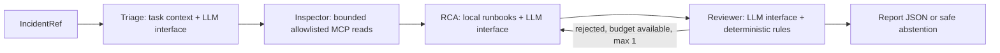

# DataOps Observability Copilot — 후보 C

선택된 C의 세 번째 체크포인트입니다. **실제 Airflow·PostgreSQL·dbt·조회 전용 MCP에 더해, 명시적으로 켜는 GPT-6 Luna 진단·의미 검토를 연결했습니다.** 저장된 실제 스키마 장애 증거로 진단과 검토가 통과했습니다. 이번 LLM 검증은 증거 재생이며 새 실시간 파이프라인 조회가 아닙니다. 기본 실행과 테스트는 비용이 없는 fake를 사용합니다. 전체 검사는 71개입니다. 상위 `CHECKPOINT_3.md`, `docs/LLM_COST_SECURITY.md`에 키 보안·비용·검증 한계를 기록했습니다. 원본 PDR/ADR은 읽기 전용으로 보존합니다.

## 실행

Python 3.11과 uv가 필요합니다. 이 환경에서 검증한 버전은 Python 3.11.15, FastMCP 2.14.7, MCP SDK 1.30.0, LangGraph 1.2.16, Pydantic 2.14.1입니다. 전체 전이 의존성은 `uv.lock`, 설치 실측 목록은 `artifacts/versions.log`에 있습니다.

실제 파이프라인은 Docker Desktop도 사용합니다. Airflow 2.10.4와 dbt Core 1.9.10·postgres 1.9.1은 Linux Python 3.11.11의 분리된 환경에서, PostgreSQL 17.10은 전용 컨테이너에서 실행합니다.

```bash
cd /Users/lim/Documents/Codex/2026-10-20/dataops-candidate-c/outputs/dataops-copilot
uv run python scripts/setup_local.py
uv run python scripts/dev_services.py start
uv run python scripts/live_e2e.py
uv run python scripts/live_limits.py
uv run python scripts/live_post_recovery.py
uv run python scripts/dev_services.py stop
```

초기화·주입·조치는 개발자 스크립트만 수행합니다. 이 세션 소유 마커가 있는 `dataops_c_cp2` DB만 변경하며, stop은 전용 서비스만 중지하고 데이터·증거를 보존합니다. 사용자 기존 DB나 볼륨은 초기화하지 않습니다. 개별 실제 진단은 아래처럼 실행합니다.

```bash
uv run dataops-copilot \
  --settings /Users/lim/Documents/Codex/2026-10-20/dataops-candidate-c/work/runtime/live-settings.json \
  --incident artifacts/checkpoint2/connection-incident.json \
  --output artifacts/checkpoint2/my-live-report.json
```

아래는 서비스를 사용하지 않는 기존 fixture 경로입니다.

```bash
cd /Users/lim/Documents/Codex/2026-10-20/dataops-candidate-c/outputs/dataops-copilot
uv sync --locked --python 3.11
uv run dataops-copilot --fixture schema --transport stdio --output artifacts/my-report.json
uv run pytest -q -W error::RuntimeWarning
uv run python scripts/verify_checkpoint.py
```

유료 연결은 `--llm openai --api-settings <명시적인 로컬 설정 경로>`를 함께 줄 때만 활성화됩니다. 키 값은 명령 인자로 주지 않습니다. 모델은 `gpt-6-luna`로 제한하고 자동 재시도·모델 전환을 막았습니다. 하루 $0.02·진단당 $0.01·이 로컬 장부의 누적 $0.05를 선예약으로 검사합니다. 이는 공용 키의 계정 전체 청구 상한이 아닙니다. 명령과 상세 정책은 `docs/LLM_COST_SECURITY.md`를 따릅니다.

`--fixture`는 `schema`, `quality`, `connection`, `normal`, `insufficient` 중 선택합니다. 이는 개발자가 합성 어댑터를 고르는 인자이며 LLM payload에는 주입 시나리오·정답 필드를 넣지 않습니다. `--transport direct`는 동일 계약의 함수 호출이며 MCP 검증으로 계산하지 않습니다. 기본값 `stdio`는 별도 FastMCP 프로세스를 열어 공식 SDK로 초기화·목록·도구 호출을 수행하고 컨텍스트 종료 시 닫습니다. 서비스 시작은 별도 개발자 명령입니다.

보고서의 `review.accepted`는 검토 통과이며 복구 성공이 아닙니다. 정상·근거 부족도 적절한 보고서이면 CLI 종료 코드가 0입니다. 검토 거절·예산 초과·실행 실패는 종료 코드 2이며 UNKNOWN과 복구안 없는 결과를 저장합니다. 토큰·비용 미수집은 `null`입니다.

## 흐름과 교체 지점



- `models.py`: IncidentRef, Evidence, Diagnosis, RecoveryAction, Review, Report, RecoveryCheck를 Pydantic으로 검증합니다. 비어 있는 대상, 시간대 없는 시각, 모순된 상태와 부족 근거에서의 복구안을 거부합니다.
- `workflow.py`: 실제 LangGraph StateGraph, 네 역할, 한 번의 재작성 분기, 타임아웃·호출 예산·제한 재시도, 부분 결과와 로컬 보고서를 연결합니다. 추가 조사 루프는 이번 체크포인트에서 구현하지 않아 `replan_count=0`입니다.
- `llm.py`의 `LLMClient.complete(role, system_prompt, payload)`: 제공자 주입 경계입니다. `prompts/*.md`를 실제 읽어 전달합니다. 기본 `FakeLLM`과 선택적 `openai_llm.py`의 실제 Responses API를 주입합니다. 실제 의미 검토는 별도 Reviewer 호출이며 같은 Luna 모델을 사용합니다. 다른 모델·사람의 독립 평가는 아닙니다.
- `fixtures.py`의 `ToolClient.call(tool, arguments)`: 수집기 주입 경계입니다. `FixtureAdapter`는 모의 결과, `live_adapter.py`는 실제 Airflow 2.10.4 `/api/v1`와 고정 PostgreSQL 조회, `MCPToolClient`는 실제 프로토콜을 사용합니다. `live_settings.py`는 명시적으로 지정한 Viewer·DB 읽기 계정 설정만 받습니다.
- `mcp_server.py`: 별도 `fastmcp` 패키지를 사용해 다섯 조회 도구만 노출합니다. 입력을 허용 목록으로 제한하며 임의 SQL·쓰기·셸 도구를 등록하지 않습니다. 실제 DB의 INSERT·UPDATE·CREATE 거부와 Airflow Viewer의 쓰기 403을 별도로 검증했습니다.
- `artifact_store.py`: 실행·태스크·시도·호출별 불변 보관, manifest/run_results invocation 대조와 해시 검사입니다. 연결 실패로 run_results가 미생성되면 부분 자료로 표시하며, 실제 invocation이 검증된 manifest·명령 로그만 사용하고 없는 결과를 만들지 않습니다.
- `pipeline/driver.py`, `pipeline/dags/`: 격리 데모 DB의 개발자 전용 초기화·주입·dbt 실행·조치와 실제 DAG입니다. 에이전트 도구에 등록하지 않습니다.
- `rules.py`: 실행·태스크·시도·invocation, 근거 ID, 필수 근거 인용, 조치 대상·종류·런북, 금지 실행 텍스트를 검사합니다. 위조 근거가 포함된 결과는 한 번 재작성 후에도 실패하면 판단 보류로 바뀝니다.
- `retrieval.py`: 직접 작성한 런북 3개를 단어 겹침으로 검색하며 문서 ID·버전·해시를 반환합니다. **BM25/Dense/RRF·Qdrant·E5 및 9+3 문서 구성은 미구현**입니다. 검색 결과가 3개라는 이유로 Hit@3 성능을 주장하지 않습니다.
- `recovery.py`: 별도 후속 run의 모든 태스크 및 필수 두 품질 검사 성공을 확인합니다. 실제 E2E에서 개발자 스크립트로 조치한 후속 실행과 집계 정합성까지 검증했습니다. 사람이 직접 편집한 시연은 아닙니다.

## 판단과 안전한 종료

현재 스키마·품질·연결 조회는 `current_observation`, 실행 로그·dbt 산출물은 `run_snapshot`입니다. 정상 기준은 별도 baseline ID와 시각을 보관합니다. 현재 컬럼 차이만으로 과거 장애 원인을 확정하지 않고, 선택된 실행의 로그·산출물과 함께 대조합니다. 과거 run·다른 시도·다른 invocation 자료는 보고서에 경고로 남기고 LLM payload에서 격리합니다.

스키마 변경은 계약/모델 매핑 검토, 데이터 품질은 승인된 정정/격리, 연결 실패는 실제 dbt 실행 설정 확인을 사람에게 안내합니다. `mcp_readonly` 접속 성공은 `dbt_orders` 복구를 뜻하지 않습니다. 포트 정보가 없으면 잘못된 포트를 확정하지 않습니다. NORMAL은 조치가 없고 필수 증거 부족은 UNKNOWN/insufficient이며, 오류·상한 초과는 UNKNOWN/failed입니다.

기본 상한은 도구 10초, LLM 30초, 전체 180초, LLM 6회, 도구 10회, 검색 2회입니다. 재작성은 최대 1회이며 모든 재시도가 같은 예산을 소비합니다. retryable인 unavailable만 최초 포함 최대 3회 재시도하고 인증 거부·invalid_input은 반복하지 않습니다. 재시도 대기는 0.5/1.5초와 작은 지터입니다. 이 수치는 설정된 상한이며 실측 응답 보장이 아닙니다.

현재 안전 검사는 제한된 데모 대상을 위한 규칙입니다. 임의 LLM의 모든 문장·인과관계를 증명하지는 않습니다. fake Reviewer는 테스트 대역이고, 실제 Reviewer는 같은 모델의 별도 의미 검토 호출입니다. 실제 모델의 광범위한 정확도·공격 입력 평가는 남았습니다. 외부 LangSmith 추적은 실행 컨텍스트에서 명시적으로 비활성화합니다. 제공자 키는 사용자가 지정한 로컬 파일만 읽고 모델 본문·로그·결과물에 기록하지 않습니다. 다른 비밀 파일과 계정 인증 파일은 검색하지 않습니다. `.env.example`은 자동 로드하지 않습니다.

## 검증 자료

`artifacts/verification.json`은 실제 명령·종료 코드·시간·로그 경로를 기록합니다. `artifacts/test-results.xml`과 `tests.log`는 테스트 결과, `protocol-session.json`은 initialize 응답·5개 도구 스키마·8회 도구 응답을 보존합니다. `schema.json`, `quality.json`, `connection.json`, `normal.json`, `insufficient.json`은 실제 stdio를 통과한 합성 보고서입니다. 보고서에 노드 순서·오류·호출량·프롬프트 해시·문서 해시·근거 해시를 보관합니다.

위 파일은 첫 체크포인트 자료로 유지합니다. 실제 시스템 기록은 `artifacts/checkpoint2/`입니다. `live-e2e.json`에 실제 정상 1회·장애 3회·후속 3회 및 복구 3건, `live-limits.json`에 8개 NULL 중 5개 샘플과 최대 40,000바이트 로그 반환, `post-recovery-negatives.json`에 복구 후 과거 실패 유지와 잘못된 연결 대상 차단을 기록합니다. 실제 성공 조합의 이미지 ID·digest와 전체 의존성은 `services.json` 및 `deployment/*-docker-resolved.txt`에 있습니다. 당시 LLM은 fake입니다. 실제 LLM 호출·토큰·단가 기반 추정 비용, 실패 이력, 무료 캐시 재실행과 보안 검사는 `artifacts/checkpoint3/`에 따로 보존합니다.

확인한 공식 API 근거: [LangGraph Graph API](https://docs.langchain.com/oss/python/langgraph/graph-api), [FastMCP 도구](https://gofastmcp.com/servers/tools), [공식 MCP Python SDK](https://github.com/modelcontextprotocol/python-sdk). 사용한 API의 실제 동작은 고정된 설치 버전과 테스트로 확인했습니다. LangChain MCP adapter와 MCP Inspector UI는 사용하지 않았습니다.

## 다음 체크포인트

실제 LLM으로 나머지 품질·연결 사례와 실시간 MCP 결합 실행, 추가 조사, BM25/Dense/RRF, Streamlit, 고정 6/12 평가셋과 단일 LLM 기준 비교가 남았습니다. 실제 시스템의 장애·복구와 실제 모델의 저장 증거 진단은 각각 확인했으며, 전체 PDR 완료나 광범위한 모델 성능은 주장하지 않습니다.
