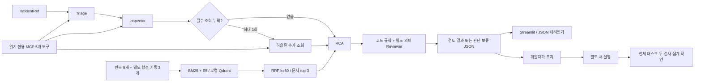

# 구현과 검증 범위

입력은 DAG·run·task·try를 지정한 IncidentRef다. 조회 전용 MCP가 실행 로그·dbt 산출물·현재 DB 관측을 모으고, 로컬 검색과 모델이 근거를 연결한다. 결과는 원인·영향·사람의 조치·검토·사용량을 담은 JSON이다. 실제 복구 여부는 별도 후속 실행과 품질·집계 검사로 확인한다.

## 검색

문서 12개는 평가셋과 독립적으로 직접 작성했다. 런북은 스키마, NULL, 연결 거부, 중복, 인증·권한, DNS, 오래된 산출물, 상류 실패, 근거 부족의 9종이다. 별도 기록 3개는 일반 대응 이력이며 평가 사례별 정답이 아니다.

`multilingual-e5-small`의 공식 qint8 ONNX 모델을 CPU에서 실행한다. revision은 `614241f622f53c4eeff9890bdc4f31cfecc418b3`으로 고정했다. query/passage 접두사, attention-mask 평균 풀링, L2 정규화를 적용한다. 제목·접두사를 포함한 350토큰, 최대 50토큰 겹침으로 청킹하고 원문·청크·요약·모델 revision을 버전으로 연결한다. 이 문서 집합은 12청크이며 모든 청크가 상한 이하다.

BM25와 Dense에서 각각 상위 10청크를 가져와 RRF k=60으로 결합하고, 같은 문서의 가장 높은 청크를 대표로 삼아 서로 다른 문서 3개를 반환한다. 서로 척도가 다른 원점수는 더하지 않는다. Qdrant는 로컬 디스크 모드이며 별도 서버·클라우드 계정·유료 임베딩 API는 사용하지 않는다. 앱·평가 프로세스는 같은 인덱스를 동시에 열지 않는다.

오류 질의는 선택 실행의 dbt `issue`·컬럼·메시지와 구체적 도메인 로그에서 만들고, 일반 Airflow wrapper 실패 문구보다 이를 우선한다. 사례 ID·정답·주입 함수 이름을 질의로 사용하지 않는다. LLM에는 직접 작성한 간결한 절차 요약을 보내고 원문과 대표 청크를 보고서에 함께 보존한다. 초기 모델 다운로드·인덱스 구축은 진단 지연에서 분리한다. qint8과 원본 float 모델의 검색 성능 동등성 비교는 하지 않았다.

## 네 역할과 안전한 추가 조회

Triage는 잠정 범주를 제안하고 Inspector는 허용된 조회만 선택한다. 코드가 필수 조회의 미시도 여부를 확인해 최대 한 번 추가 수집할 수 있다. 이는 정해진 정책의 누락 보완 분기이며 자유로운 자율 재계획이 아니다. 코드·단위 검사에서 4번의 LLM 호출을 유지하면서 누락 schema 조회를 보완했다.

RCA는 성공한 실제 근거 ID와 검색 문서 ID를 서로 다른 enum으로 제한한다. 현재 schema/profile과 선택 실행의 로그·산출물을 다른 시점의 자료로 다룬다. Reviewer는 같은 Luna 모델의 별도 호출이며 독립된 모델·사람이라고 부르지 않는다. 코드 규칙은 실행 식별자·invocation·근거 ID·대상·조치 종류·런북·금지 실행 텍스트를 검사한다. 일반 진단 Report의 review 통과와 RecoveryCheck의 실제 recovered는 별도다.

기본 fake 경로는 한 번의 재작성을 허용할 수 있지만 유료 경로는 네 역할 4호출 상한으로 자동 재작성을 막는다. API 실패·형식 오류·불충분한 근거·검토 거절은 조치 없는 판단 보류로 끝난다. 실제 SQL·셸·복구 실행은 에이전트 도구에 없다.

실제 MCP는 `raw.orders`와 `dbt_orders`·관측 연결 등 제한된 데모 대상만 조회한다. 고정 합성 평가의 `raw.web_orders`, `raw.orders_archive`는 별도의 허용된 재생 도메인이며 실제 DB에 이 테이블을 만들어 조회한 것으로 세지 않는다.

## 화면과 세션

Streamlit은 저장 결과를 먼저 보여준다. 명시적인 form 제출만 새 진단을 시작하며 API 사용은 기본 해제다. 매 실행이 새 asyncio 루프·MCP 연결 컨텍스트를 만들고 닫는다. 모델·MCP 클라이언트를 세션 상태에 저장하지 않는다. 세션 상태에는 결과 JSON만 두고 프로세스의 실행 잠금으로 중복 진단을 막는다.

실제 Playwright Chromium에서 세 장애 선택, 증거 펼치기, 복구 탭, JSON 다운로드, 새로고침을 수행했다. API 장부는 전후 83→83으로 추가 호출 0회였고 브라우저 페이지 오류는 0개였다. 캡처 5장은 실제 실행 화면이며 합성 UI 이미지가 아니다.

## 실제 통합과 테스트

Airflow 2.10.4·PostgreSQL 17.10·dbt Core 1.9.10의 정상 1회, 장애 3회, 조치 후 새 실행 3회를 확인했다. 세 실패는 Luna로 진단했다. 품질·연결의 문제 해결 후에는 같은 실제 증거 재생으로 필요한 역할만 수동 재검사했다. 정상·복구 판정용 수집은 fake를 사용했고 실제 성공 상태·품질·집계는 코드와 도구 결과로 검증했다.

세 후속 실행 모두 태스크 4개 성공, not_null·unique 통과, 원본·staging·일별 집계 1,000건·502,360.39, NULL·중복 0개다. 개발자 스크립트가 조치했으며 사람이 직접 파일을 편집한 시연으로 표현하지 않는다. 이후 좁힌 컨테이너 마운트에서도 별도 새 정상 실행을 확인했다.

현재 pytest는 86개다. 6개는 stdio와 fixture backend의 실제 MCP 프로토콜 검사이며 나머지 80개는 계약·HTTP 대역·파서·규칙·비용·실제 로컬 임베딩/Qdrant·Streamlit 검사다. 별도 실제 서비스 E2E, 브라우저 검증, 최종 모델 비교를 이 86개에 섞어 세지 않았다.

한계와 성능 미달은 `EVALUATION_REPORT.md`에 있다. 일반적인 자동 복구, 운영 배포, 외부 운영 데이터, 멀티 사용자 인증, MCP Inspector UI·LangChain adapter 사용은 이번 완료 주장에 포함하지 않는다.
